# Run via UI

Create an audio RAG experiment in the OpenShift AI dashboard, compare the resulting patterns
and use a selected pattern for questions or full-corpus indexing.

[Sample overview](../README.md) · [Run via code](run-via-code.md)

## Prerequisites

Before creating a run:

1. Sign in to OpenShift AI and create a project, or select an existing project you can use.
2. Configure the project's pipeline server and its artifact storage. Wait until the server is
   ready and the managed AutoRAG optimization and indexing pipelines are available.
3. Add Connections in that project for S3 storage, MaaS and your selected database:
   Milvus, PGVector or Neo4j. Check that they appear in the AutoRAG selectors.
4. Make sure MaaS serves the embedding and generation models you intend to select.
5. Upload the recordings to S3 and prepare a benchmark with source keys matching those recordings.

See [project setup](prerequisites.md#create-or-select-a-project) and
[Connection requirements](prerequisites.md#connections-and-credentials) for the required secret keys.
If you already have Kubernetes secrets, register them as
[dashboard Connections](prerequisites.md#make-existing-secrets-visible-in-the-ui) before using the selectors.

Configuration for this walkthrough is entered in the dashboard.

## Prepare the sample data

Upload the three recordings from `data/rag/audio/sample/documents/` to your S3 bucket.
Keep the repository's directory structure so that their object keys are:

```text
data/rag/audio/sample/documents/story_10.mp3
data/rag/audio/sample/documents/story_100.mp3
data/rag/audio/sample/documents/story_1015.mp3
```

Upload `data/rag/audio/sample/benchmark.json` to
`data/rag/audio/sample/benchmark.json` in the bucket, or select that local benchmark file when
the dashboard offers local evaluation-dataset upload. Its source keys must match the uploaded
recordings. Keep reference transcripts outside the selected documents directory.

The S3 Connection must provide access to the selected bucket and recordings. Use the
[benchmark format](../data/README.md) when preparing your own data. If you choose different S3 keys,
update every corresponding `correct_answer_document_keys` entry in the benchmark.

>!note
> Why that path `data/rag/audio/sample/benchmark.json` need to be exact the same?
> Because we are using in the AI4RAG repository precise key paths. Which mean that
> file benchmark.json need to provide the full path to the targeted files for questions.
> You can use your own files, but remember that You need to write a full correct path.

## Open AutoRAG

Sign in to the cluster and open the OpenShift AI dashboard.

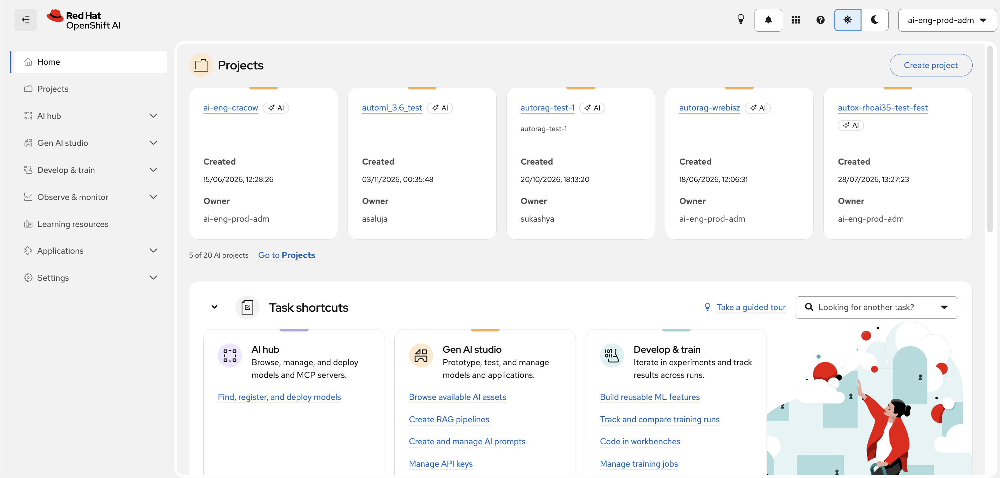

Go to **Gen AI Studio → AutoRAG**, select your project and choose **Create Run**.

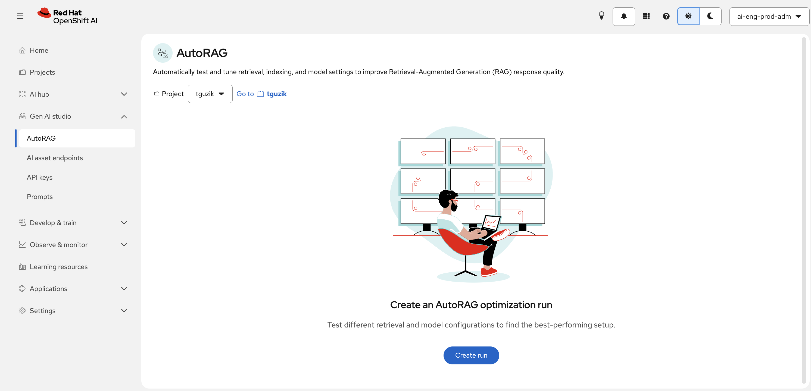

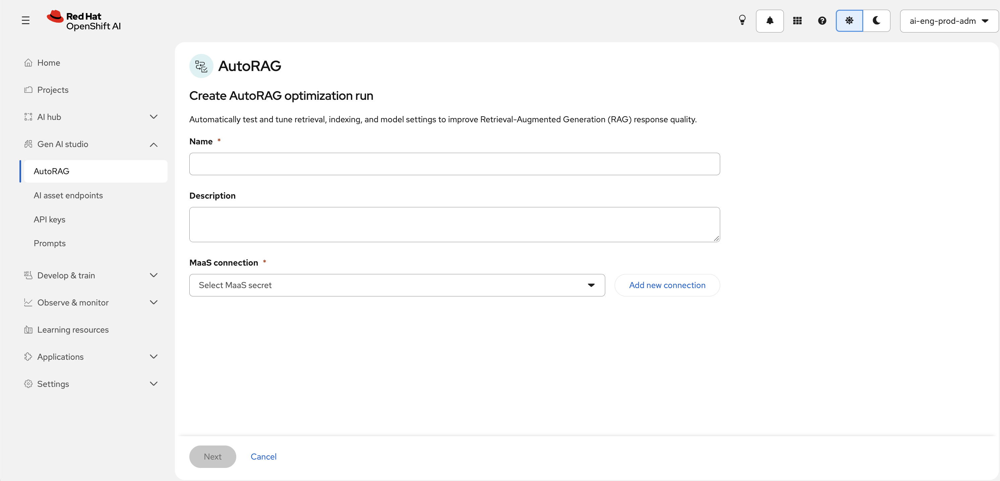

## Configure the run

### Name and model connection

Enter the run name and description, then select the project's MaaS Connection.

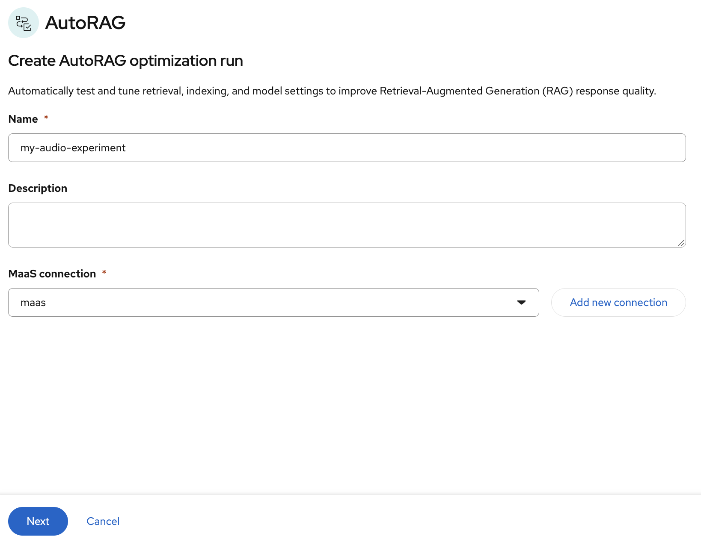

### Recordings in S3

Select the S3 Connection and bucket, then browse to `data/rag/audio/sample/documents/`
and select the recordings to use.

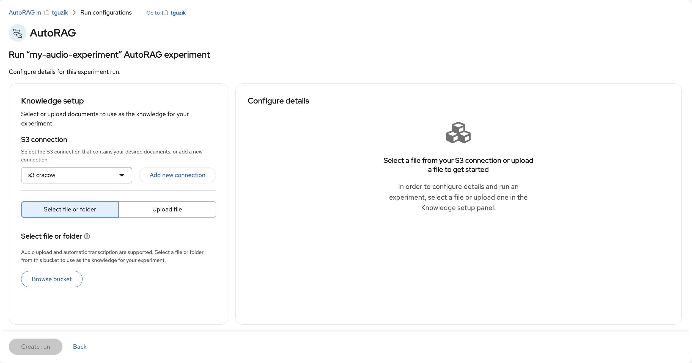

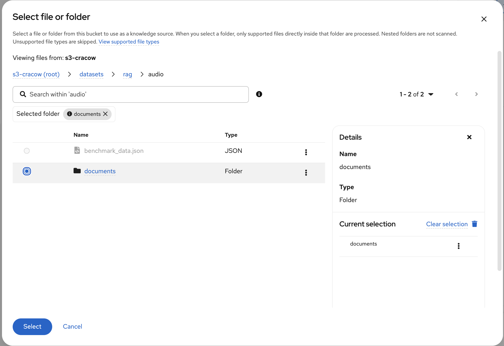

The screenshots show example project names and object keys. Use your project's Connections and
the sample paths above.

### Database, benchmark and preset

Select the Milvus, PGVector or Neo4j Connection you prepared in the same project.
Select the evaluation benchmark from S3 or upload the local JSON file using the available
dashboard option.

Choose a run preset. The screenshots show **Faster** and **Better quality**; use the resource
requirements displayed by your installed version when deciding which fits your project.

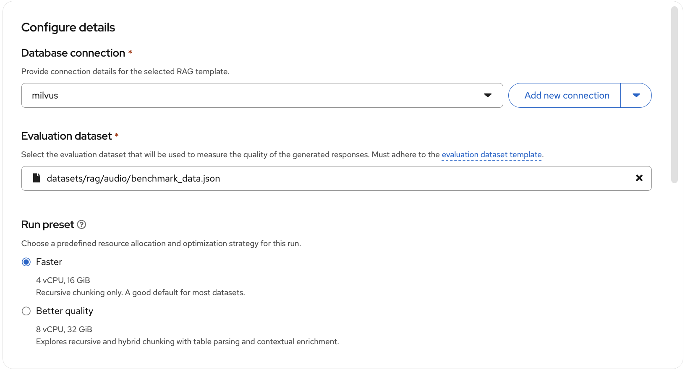

### Metric, pattern count and models

Choose the optimization metric, maximum number of RAG patterns, embedding models and generation
models. The code walkthrough's defaults are `answer_correctness`, four patterns and preset
`speed`; choose the corresponding options available in your dashboard.

For Neo4j, the generation model is also used to extract the knowledge graph. Ensure the
Connection and models satisfy the [Neo4j prerequisites](prerequisites.md#connections-and-credentials).

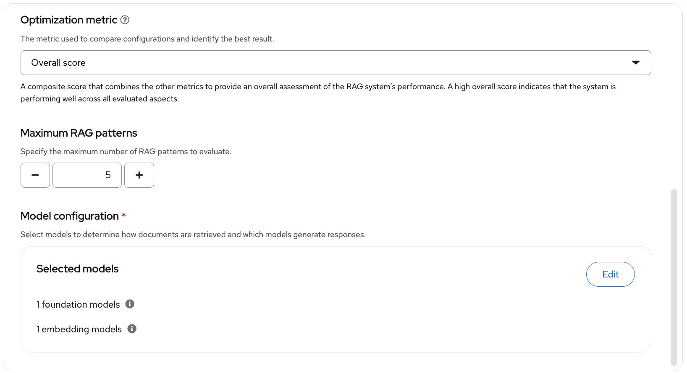

## Start and inspect the experiment

Review the selected project, Connections, recordings, benchmark and models, then choose
**Create New Run**.


Wait for the run to finish. Inspect the status, pattern scores and per-pattern settings.
If the run fails, check its pipeline tasks and [troubleshooting](troubleshooting.md) before retrying.
Verify that transcription covered each selected recording.

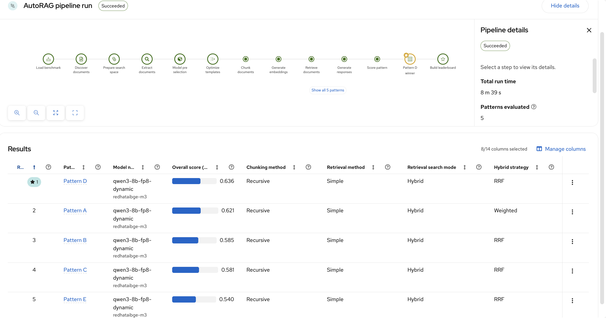

The run creates artifacts in S3 containing experiment information, patterns and evaluation
results. Use the run's artifact links or your storage browser to inspect them Runs → Artifacts.

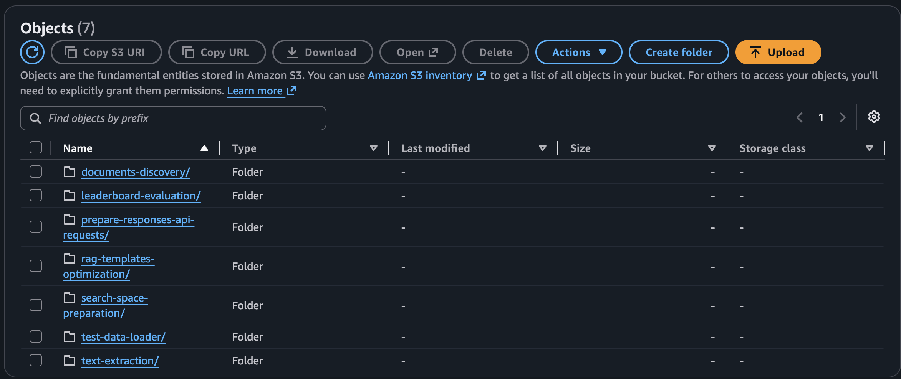

## Select a pattern, index and ask

Open a pattern's actions menu. Available actions include **Try this pattern**, **View details**,
**Run indexing pipeline**, **Save as indexing notebook** and **Save as inference notebook**.

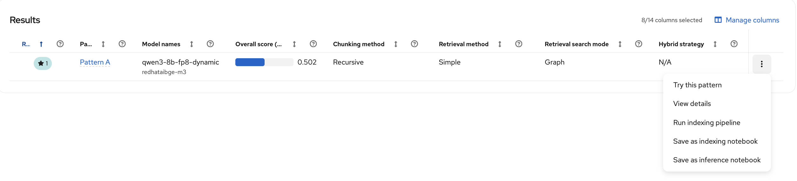

Choose **Try this pattern** to ask questions against that pattern's optimization collection.
Compare the answer with the retrieved sources and the original recording.

To start indexing from the dashboard:

1. Choose **Run indexing pipeline** for the selected pattern.
2. Enter a run name and optional description. Expand **Show run parameters** to review the
   saved input paths, collection, models and Connection secret names.
3. Choose **Run**, follow its progress on the **Runs** page and wait for it to complete successfully.
4. Save the pattern's inference notebook and open it in an OpenShift AI workbench.
   Attach the MaaS and database Connections, then set its `collection_name` to the collection
   populated by the indexing run.
5. Run the setup and inference cells. Preserve the generated embedding and retrieval settings;
   Neo4j uses the graph inference notebook.

The current indexing dialog reuses the pattern's saved parameters. To index a different corpus
or use a fresh collection, choose **Save as indexing notebook** and configure those inputs in
the downloaded notebook, keeping the pattern's model and chunking settings and the same database
Connection. You can also use the [code indexing workflow](run-via-code.md#select-a-pattern-index-and-ask).
Point the inference notebook at the collection populated by that indexing run.

For the bundled sample, ask:

> What kind of animal did Billy keep as a pet?

Expected answer: **A goat**, supported by `story_10.mp3`. This is a reference answer;
verify the observed answer and retrieved source against the recording.

Record the optimization and indexing run IDs, selected pattern, collection and one checked answer.
See the [acceptance checklist](validation.md) for the remaining product checks.

[Back to the sample overview](../README.md)
